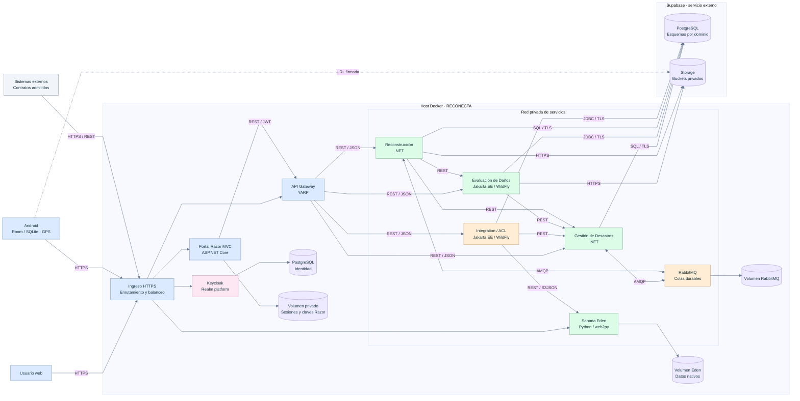
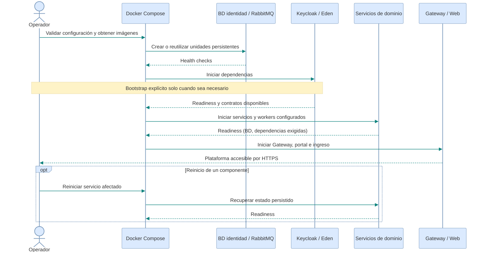
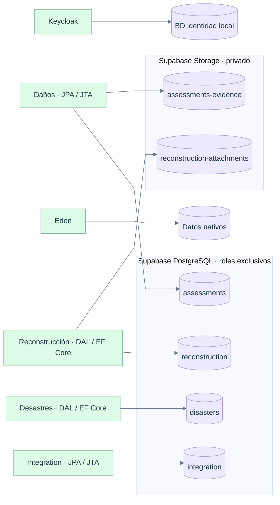

<div align="center">

# RECONECTA

### Infraestructura y despliegue de la plataforma

*De la emergencia a la reconstrucción*


**Pontificia Universidad Javeriana · Arquitectura de Software · 2026**

[Organización](https://github.com/disaster-management-platform) · [Videos](#videos-de-la-plataforma) · [Repositorios](#repositorios-de-reconecta) · [Arquitectura](#arquitectura) · [Instalación](#instalación-y-ejecución)

</div>

> **Estado del despliegue:** esta versión del README especifica el despliegue integrado objetivo. En `main` (a4e8a1d), el repositorio contiene el stack de identidad y sus pruebas, pero aún no el Compose central de toda la plataforma. Los archivos y comandos identificados como objetivo deben implementarse y verificarse antes de considerar reproducible la instalación. Las imágenes, puertos, nombres DNS y referencias de versión finales deben corresponder al manifiesto entregado, no a contenedores temporales de desarrollo.

## Videos de la plataforma

### Demostración funcional

<div align="center">

[](https://youtu.be/7aJHeuPysIk)

[Ver demostración completa en YouTube](https://youtu.be/7aJHeuPysIk)

</div>


## Repositorios de RECONECTA

Este repositorio centraliza el despliegue de toda la plataforma. El código fuente de cada componente se mantiene en su propio repositorio de la [organización RECONECTA](https://github.com/disaster-management-platform).


| Repositorio | Responsabilidad en RECONECTA |
| --- | --- |
| [disaster-platform-infrastructure](https://github.com/disaster-management-platform/disaster-platform-infrastructure) | **Este repositorio:** composición, configuración, identidad y despliegue integrado. |
| [disaster-platform-presentation](https://github.com/disaster-management-platform/disaster-platform-presentation) | Portal web Razor MVC. |
| [disaster-mobile-client](https://github.com/disaster-management-platform/disaster-mobile-client) | Android Offline First; APK separado. |
| [disaster-api-gateway](https://github.com/disaster-management-platform/disaster-api-gateway) | Gateway REST YARP. |
| [disaster-backend-offline](https://github.com/disaster-management-platform/disaster-backend-offline) | Servicio de Gestión de Desastres. |
| [disaster-damage-assessmet-service](https://github.com/disaster-management-platform/disaster-damage-assessmet-service) | Servicio de Evaluación de Daños. |
| [disaster-integration-service](https://github.com/disaster-management-platform/disaster-integration-service) | Integration / Anti-Corruption Layer. |
| [reconstruction-business-layer](https://github.com/disaster-management-platform/reconstruction-business-layer) | Servicio de Reconstrucción. |
| [sahana-eden](https://github.com/disaster-management-platform/sahana-eden) | Capacidades humanitarias nativas. |
| [disaster-platform-dal](https://github.com/disaster-management-platform/disaster-platform-dal) | Librerías .NET de persistencia, contratos y seguridad compartida. |

## Descripción

`disaster-platform-infrastructure` centraliza la configuración, el aprovisionamiento y el despliegue de RECONECTA, una plataforma de gestión de desastres y reconstrucción basada en servicios. Su responsabilidad es componer los servicios desarrollados con .NET y Jakarta EE, el portal web, el API Gateway, Sahana Eden, la identidad y la mensajería en un entorno reproducible.

No contiene reglas de negocio ni reemplaza los repositorios de los servicios. Cada componente conserva su código, contratos, almacenamiento propietario y ciclo de construcción. Supabase proporciona PostgreSQL y almacenamiento de objetos administrados fuera del stack Docker; Android se distribuye como APK y se ejecuta en el dispositivo del usuario.

## Contenido

- [Videos de la plataforma](#videos-de-la-plataforma)
- [Funcionalidades](#funcionalidades)
- [Arquitectura](#arquitectura)
- [Decisiones arquitectónicas y atributos de calidad](#decisiones-arquitectónicas-y-atributos-de-calidad)
- [Tecnologías y justificación](#tecnologías-y-justificación)
- [Estructura del repositorio](#estructura-del-repositorio)
- [Integración y persistencia](#integración-y-persistencia)
- [Contratos de comunicación](#contratos-de-comunicación)
- [Identidad y seguridad](#identidad-y-seguridad)
- [Instalación y ejecución](#instalación-y-ejecución)
- [Pruebas](#pruebas)
- [Repositorios de RECONECTA](#repositorios-de-reconecta)
- [Autores](#autores)

## Funcionalidades

| Capacidad | Responsabilidad |
| --- | --- |
| Despliegue integrado | Orquestar el portal, Gateway, cuatro servicios propietarios, Eden y servicios de infraestructura. |
| Reproducción | Consumir imágenes versionadas, sin construir cada aplicación manualmente ni depender de contenedores preexistentes. |
| Configuración externa | Separar direcciones, límites de recursos, credenciales, certificados y configuración de cada dominio de sus imágenes. |
| Identidad | Aprovisionar Keycloak, realm `platform`, clientes OIDC, roles y cuentas técnicas. |
| Mensajería | Configurar RabbitMQ y habilitar los productores y consumidores ya implementados donde corresponda. |
| Operación | Comprobar readiness, reiniciar componentes, consultar logs y conservar los datos persistentes. |
| Escalamiento | Permitir incrementar réplicas de componentes stateless selectivamente, bajo un perfil validado. |

## Arquitectura

La infraestructura materializa la arquitectura SBA (*Service-Based Architecture*) de RECONECTA. Docker Compose describe contenedores, redes, volúmenes, configuración y dependencias de arranque. YARP conserva su responsabilidad de Gateway de APIs; el ingreso HTTPS público y el balanceo de réplicas se configuran sin trasladar las reglas de negocio al proxy.

### Vista de despliegue objetivo



Keycloak es una dependencia transversal: los clientes solicitan autenticación OIDC y los servicios validan JWT con el issuer y JWKS configurados. Las conexiones de identidad no se repiten para todos los componentes con el fin de mantener legible la vista. Las rutas nativas de Eden son una exposición explícita, no un acceso directo a su base de datos ni una omisión de sus ACL. Las integraciones con hospitales, GIS y financiación real están limitadas a los contratos efectivamente disponibles; no se presupone que existan conectores externos completos.

### Componentes del despliegue

| Servicio Compose propuesto | Unidad ejecutable | Persistencia |
| --- | --- | --- |
| `ingress` | Ingreso HTTPS configurable | Certificados externos |
| `web` | Portal Razor MVC | Claves de Data Protection y tickets de sesión |
| `gateway` | API Gateway YARP | Configuración externa; sin BD propia |
| `disasters` | API de Desastres .NET | `disasters` en Supabase |
| `damage` | WAR de Daños en WildFly | `assessments` y Storage privado |
| `integration` | WAR Integration en WildFly | `integration`: recibos y correlaciones |
| `reconstruction` | API de Reconstrucción .NET | `reconstruction` y Storage privado |
| `eden` | Aplicación Eden con plantilla `platform` | Almacenamiento nativo persistente |
| `rabbitmq` | Broker AMQP | Volumen de datos del broker |
| `keycloak` | Proveedor de identidad | Base de identidad dedicada |
| `identity-db` | PostgreSQL de Keycloak | Volumen de identidad persistente |

El DAL .NET se incorpora a los servicios mediante NuGet durante su construcción; no es un servidor ni un contenedor independiente. Los workers existentes pueden ejecutarse dentro de los servicios correspondientes; no se duplican por defecto como aplicaciones distintas.

### Secuencia de arranque y recuperación



La secuencia distingue disponibilidad del proceso y disponibilidad para atender tráfico. No todas las dependencias son obligatorias para todos los servicios: una integración externa degradada no debe impedir el funcionamiento de los demás dominios.

## Decisiones arquitectónicas y atributos de calidad

| Atributo | Decisión arquitectónica | Mecanismos y alcance |
| --- | --- | --- |
| Desplegabilidad | Imágenes inmutables y configuración externa | Dockerfiles por repositorio, manifiesto de versiones y Compose centralizado. |
| Disponibilidad | Supervisar instancias y preservar estado | Health checks, reinicio controlado, volúmenes; réplicas y balanceo como objetivo de validación. |
| Escalabilidad | Desplegar servicios por separado | Scale-out selectivo, redes privadas, pools limitados por instancia, consumidores concurrentes. |
| Interoperabilidad | Integrar runtimes heterogéneos | REST/JSON, AMQP, OIDC y DNS de servicios, sin dependencia del lenguaje. |
| Resiliencia | Desacoplar arranque y procesamiento | Readiness, redelivery, Outbox/Inbox existentes, timeouts y recuperación de servicios. |
| Seguridad | Aislar identidades, red y configuración | TLS, Keycloak, roles técnicos mínimos, archivos protegidos y rutas privadas. |
| Modificabilidad | Separar infraestructura de código de negocio | Actualización selectiva de imágenes y contratos de configuración versionados. |

**Compromiso:** Docker Compose en un único host no tolera por sí solo la caída de ese host. Persistir un volumen no equivale a disponer de una réplica ni de un respaldo. Escalar los servicios incrementa el consumo de conexiones PostgreSQL, CPU y memoria. El failover de bases de datos, broker e identidad y los objetivos de 99,95 % de disponibilidad y 10.000 usuarios requieren infraestructura y mediciones adicionales; no son resultados de este README.

## Tecnologías y justificación

| Tecnología | Papel dentro de RECONECTA | Justificación arquitectónica |
| --- | --- | --- |
| Docker | Empaquetado de aplicaciones servidoras | Aísla .NET, WildFly y Python con sus dependencias. Permite transportar la misma imagen probada a otro host sin instalar los runtimes de cada lenguaje. |
| Docker Compose | Composición del entorno integrado | Modela servicios, redes, volúmenes y condiciones de arranque en una configuración versionada. Adecuado para la reproducción del proyecto; no sustituye un orquestador multinodo. |
| GitHub Container Registry (GHCR) | Distribución de imágenes de RECONECTA (objetivo) | Vincula las versiones publicadas con los repositorios de código y permite `pull` sin descargar fuentes ni exponer credenciales NuGet en ejecución. Las imágenes deben quedar fijadas a versiones o digests verificables. |
| YARP / ASP.NET Core | Gateway REST | Integra servicios .NET y Java mediante contratos HTTP independientes del lenguaje. Centraliza rutas y balanceo de APIs, mientras los propietarios conservan las reglas de autorización y negocio. |
| Keycloak | Identity Provider | Proporciona un issuer común para portal, Android y servicios técnicos mediante OIDC/OAuth 2.0. Evita implementar identidad distinta por componente y habilita RBAC/ABAC en los servicios. |
| RabbitMQ | Broker AMQP | Desacopla publicación y procesamiento asíncrono de Desastres y Reconstrucción. Colas durables, confirmaciones y consumidores complementan Outbox e Inbox sin exigir transacciones distribuidas. |
| Supabase / PostgreSQL | Persistencia administrada de dominios | Permite a .NET y Jakarta acceder mediante Npgsql/EF Core y JDBC/JPA a una plataforma relacional común, con aislamiento lógico por esquema y login y transacciones ACID locales. Storage privado separa binarios de metadatos y admite carga de evidencias con URL firmada. |
| PostgreSQL de identidad | Persistencia Keycloak | Aísla usuarios, sesiones y configuración del proveedor de identidad de las bases de negocio y evita otorgarle permisos sobre sus esquemas. |
| .NET, Jakarta EE y Eden | Runtimes de las aplicaciones empacadas | Se reutilizan las imágenes de los equipos propietarios: .NET para Web/Gateway/Desastres/Reconstrucción, WildFly para Daños/Integration y Python/web2py para capacidades humanitarias nativas, sin imponer una reescritura tecnológica. |

## Estructura del repositorio

Estructura objetivo; el directorio `security/` ya existe y se conserva, incluidos los scripts y pruebas de identidad actuales.

```text
disaster-platform-infrastructure/
├── compose.yaml                 # Stack integrado, imagen por servicio
├── .env.example                 # Variables no secretas y referencias externas
├── config.example/               # Plantillas por componente, sin credenciales
├── config/                       # Configuración real local, ignorada por Git
├── security/
│   ├── compose.yaml              # Stack de identidad independiente existente
│   ├── bootstrap.yaml
│   ├── configure.py
│   ├── init-database.sh
│   ├── test_identity.py
│   └── test_consumers.py
├── scripts/
│   ├── bootstrap.sh              # Aprovisionamiento explícito, idempotente
│   └── smoke-test.sh             # Comprobación integrada
├── docs/
│   └── identity.md               # Detalle de aprovisionamiento y contratos
├── .gitignore
└── README.md
```

Los scripts y rutas nuevas son requisitos del despliegue objetivo. Las plantillas de `config.example/` deben describir todas las variables obligatorias, montajes y certificados consumidos por las imágenes reales.

## Integración y persistencia



Cada dominio es propietario de sus escrituras. Las consultas entre dominios utilizan APIs y no accesos directos a tablas ajenas. Se mantiene el proyecto Supabase ya aprovisionado, sus migraciones, roles, buckets y registros de demostración. Las migraciones son explícitas y administrativas; no se ejecutan automáticamente al iniciar réplicas. Las conexiones a PostgreSQL verifican TLS (`VerifyFull` / `verify-full`) mediante una CA confiable.

La persistencia nativa de Eden, la base de identidad, el broker y las claves/tickets de Razor sobreviven a la recreación de contenedores. Antes de adoptar volúmenes existentes, verificar su nombre, propietario y compatibilidad; cualquier traslado requiere respaldo y un procedimiento de migración explícito. No usar `docker compose down -v` sobre entornos con datos.

## Contratos de comunicación

| Origen → destino | Mecanismo | Uso |
| --- | --- | --- |
| Navegador → ingreso/portal | HTTPS | Interfaz web y sesión de usuario. |
| Android → Gateway | HTTPS / REST / JSON | Registro, evaluación y sincronización. |
| Portal → Gateway → servicios | HTTP(S) privado / REST / JWT | Propagación de identidad y operaciones por dominio. |
| Sistemas externos → Gateway → Integration | HTTPS / REST | Recepción de reportes normalizados admitidos. |
| Integration → Eden | HTTP(S) / REST / S3JSON | Operaciones nativas con delegación de organización. |
| Daños / Integration / Reconstrucción → Desastres | REST / OAuth 2.0 Client Credentials | Consultas de recursos y reportes según permisos. |
| Reconstrucción → Daños | REST / JSON | Evaluaciones validadas. |
| Desastres / Reconstrucción ↔ RabbitMQ | AMQP | Publicación y consumo de mensajes implementados. |
| Servicios → Supabase | PostgreSQL / TLS; HTTPS Storage | Persistencia y evidencias. |
| Aplicaciones ↔ Keycloak | HTTPS / OIDC / OAuth 2.0 | Autenticación, tokens y descubrimiento de claves. |

El ingreso público, callbacks OIDC y direcciones utilizadas por Android deben corresponder a las URLs del entorno desplegado. No usar `localhost` como dirección de otro servicio desde un contenedor. El issuer público debe ser resoluble tanto desde los clientes como desde los contenedores validadores, con el mismo nombre, certificado y URL; no sustituirlo por un nombre interno distinto en la validación del JWT. Las rutas externas de Eden mantienen sus controles nativos. Los protocolos y cifrado de los saltos internos deben documentarse y validarse de acuerdo con las restricciones del SAD; la red privada no sustituye TLS cuando este sea obligatorio.

## Identidad y seguridad

Este repositorio sí implementa directamente la infraestructura de identidad, por lo que la sección forma parte de sus responsabilidades. Se conserva el realm `platform`, los clientes `razor-web` (confidencial) y `android` (público), Authorization Code con PKCE S256 y los clientes técnicos con Client Credentials. El login humano utiliza usuario y contraseña, sin MFA obligatorio, también al recrear el entorno. Los roles y atributos `sub`, `role`, `organization_id` y `disaster_id` se aprovisionan conforme a la configuración del dominio; la autorización fina permanece en el propietario del recurso y en AuthS3 para Eden.

- Exponer únicamente el ingreso y las aplicaciones expresamente autorizadas. No publicar PostgreSQL, AMQP, consolas administrativas ni puertos internos de WildFly.
- Conservar HTTPS y las verificaciones de issuer, audiencia, firma, expiración y certificados. No habilitar bypasses de autenticación, password grants para los clientes humanos ni credenciales embebidas.
- Mantener separadas las identidades de administración, migración y ejecución. Retirar el acceso temporal de bootstrap al finalizar. Las imágenes no contienen secretos.
- Conservar claves de protección de datos y tickets de Razor de manera privada y persistente, compartidos únicamente entre sus réplicas, evitando cookies con JWT completos.
- Usar configuración externa con permisos restrictivos. No publicar contraseñas reales, secretos OIDC, cadenas de conexión, claves administrativas de Storage ni certificados privados. Las cuentas demo con contraseña común son exclusivamente para una reproducción controlada, no para un entorno público.

Para los detalles existentes de identidad, migración de usuarios PostgreSQL y provisión de clientes, véase `docs/identity.md` (documento objetivo que preservará la información de identidad del README actual).

## Instalación y ejecución

> Procedimiento objetivo que Codex debe poner en funcionamiento y comprobar desde un entorno limpio. Los pasos no dependen de los contenedores `task10-*`, del árbol de fuentes de los otros repositorios ni de instalaciones locales de .NET/Java para ejecutar el backend.

### 1. Prerrequisitos

- Docker Engine y plugin Docker Compose v2 compatible con `up --wait`.
- Git; autenticación de lectura a GHCR si las imágenes son privadas.
- Proyecto Supabase ya preparado, credenciales por dominio, identidades de Storage y certificados de CA.
- URLs públicas/locales coherentes, resolución de nombres y certificados confiables para navegador, contenedores y Android.
- Credenciales administrativas de aprovisionamiento de Keycloak y delegaciones nativas de Eden, suministradas por el responsable del entorno.

```bash
git clone https://github.com/disaster-management-platform/disaster-platform-infrastructure.git
cd disaster-platform-infrastructure
cp .env.example .env
cp -r config.example config
chmod 700 config
chmod 600 .env
```

Completar los archivos de configuración con los valores autorizados antes de continuar. Proteger también cada archivo que contenga credenciales con permisos `600`; los certificados y montajes deben seguir siendo accesibles para el usuario no root de la imagen correspondiente. No sobrescribir la configuración existente al actualizar.

### 2. Configurar el entorno

| Configuración | Contenido |
| --- | --- |
| `.env` | Referencias exactas de imágenes, URLs de entrada, puertos y rutas de montajes externos. |
| `config/` | Perfiles de cada servicio, credenciales por dominio, archivos de confianza, delegaciones y configuración del ingreso. |
| Supabase | Conexiones privadas, CA, buckets y permisos existentes; nunca una clave administrativa de Storage en runtime. |
| Keycloak | `KC_PUBLIC_URL`, callbacks, contraseñas de BD y credenciales temporales de bootstrap; secretos de clientes almacenados fuera de Git. |
| RabbitMQ | Usuario y contraseña técnicos, colas y configuración consistente con productores/consumidores. |
| Worker profiles | Dispatcher/Consumers de Desastres y mensajería de Reconstrucción activados en el stack integrado. |

Las variables específicas de las imágenes se trasladan de sus configuraciones reales (incluidos `Security__Authority`, `JWT_ISSUER`, `ConnectionStrings__Disasters`, los parámetros de JNDI y `ExternalApis__*`) sin inventar nombres incompatibles. Las plantillas definitivas deberán contener el inventario exacto. Para instalaciones nuevas sin datos provisionados, usar los procedimientos administrativos de migración de los repositorios propietarios antes del arranque normal.

### 3. Obtener imágenes e iniciar

```bash
docker compose config --quiet
docker compose pull
# Solo para inicializar o reconciliar la configuración de identidad:
./scripts/bootstrap.sh
# Arranque normal:
docker compose up -d --wait
docker compose ps
```

`bootstrap.sh` deberá reutilizar un realm existente, conservar IDs/roles y coordinar la provisión de clientes con sus secretos externos. No volver a crear usuarios, datos de demostración o volúmenes en cada arranque. Para un entorno ya preparado, basta `docker compose up -d --wait` (tras `pull` si se actualiza la versión). El acceso se realiza mediante las URLs documentadas en `.env.example` y configuradas en el ingreso. No asumir que los puertos temporales de Task 10 coinciden con el despliegue final.

### 4. Comprobar la plataforma

```bash
./scripts/smoke-test.sh
docker compose ps
docker compose logs --tail=100 gateway web
```

El script deberá comprobar el descubrimiento OIDC, la disponibilidad de las APIs a través del Gateway y la conexión con las dependencias necesarias, sin imprimir secretos ni crear datos en un smoke test de lectura. Debe devolver un código distinto de cero si falla una comprobación obligatoria. La prueba funcional de escritura se ejecuta por separado, con fixtures sintéticos explícitamente autorizados.

### 5. Aplicación Android

Android no se ejecuta dentro de los contenedores del servidor. Se distribuye el APK compatible con la versión publicada del backend desde [disaster-mobile-client](https://github.com/disaster-management-platform/disaster-mobile-client). Configurar su URL HTTPS de Gateway, terminada en `/api/`, y el issuer/callback OIDC aplicables a esa versión. El APK de entrega debe venir de una compilación validada y conservar la identidad y los datos de Room del usuario durante una actualización compatible.

```bash
adb devices
adb install -r /ruta/al/reconecta.apk
```

La ruta anterior es un marcador del APK descargado. Codex deberá documentar el enlace o artefacto exacto, su variante validada y los parámetros reales para reproducirlo, sin incrustar tokens. La app debe probarse en un dispositivo o emulador; arrancar Compose no comprueba el flujo offline.

### 6. Operación y actualización

```bash
# Consultar logs de un componente
docker compose logs -f disasters
# Reiniciar un componente sin borrar sus datos
docker compose restart disasters
# Detener el stack conservando contenedores y volúmenes
docker compose stop
# Retomar el stack
docker compose up -d --wait
```

Para actualizar, fijar nuevas referencias de imagen en el manifiesto, comprobar compatibilidad y migraciones necesarias, obtenerlas con `docker compose pull`, y ejecutar `docker compose up -d --wait`. Mantener referencias anteriores para rollback compatible; retroceder una imagen no revierte automáticamente una migración. No borrar volúmenes ni aplicar cambios destructivos sobre los datos existentes.

### 7. Escalamiento selectivo

El perfil de escalamiento debe usar resolución de destinos y balanceo que realmente distribuyan tráfico entre réplicas saludables. No utilizar `container_name` fijo o puertos exclusivos del host para servicios replicables. Ejemplo objetivo, condicionado a esa validación:

```bash
docker compose up -d --wait --scale disasters=2
```

La configuración final deberá probar el descubrimiento y retiro de destinos en YARP/ingreso, los presupuestos de conexiones de cada pool y el uso de consumidores concurrentes sin duplicar efectos. Eden y las dependencias persistentes no se replican automáticamente con este comando. El perfil base ejecuta las unidades necesarias con capacidad local, no garantiza alta disponibilidad multinodo.

## Pruebas

| Prueba | Criterio de aceptación |
| --- | --- |
| Configuración | `docker compose config --quiet` finaliza sin error; imágenes y variables requeridas están resueltas. |
| Reproducción limpia | Desde un clon limpio y configuración autorizada, `pull` y `up` levantan los servicios sin compilar en el host ni preparar contenedores a mano. |
| Readiness | Gateway, servicios, Eden, identidad y broker alcanzan el estado de disponibilidad esperado. |
| Identidad | Inicio de sesión real en Razor con usuario/contraseña sin MFA, cierre y nuevo ingreso; rechazo de token inválido y recurso ajeno. |
| Flujo funcional | Un desastre sintético se registra y consulta por Gateway; una evaluación se valida y origina un proyecto de reconstrucción. La financiación simulada se identifica explícitamente. |
| Mensajería | Verificar aceptación durable, publicación/consumo real y reintento de un mensaje sin efectos duplicados. |
| Offline | Registro móvil sin red, reconexión, sincronización al estado final confirmado y consulta posterior del dato. |
| Persistencia | Reiniciar o recrear un componente y comprobar datos, sesiones o recibos que deban conservarse. |
| Escalamiento | Si se entrega el perfil, probar dos réplicas reales, reparto de solicitudes y retiro de una instancia sin rediseñar la aplicación. |

Los scripts `security/test_identity.py` y `security/test_consumers.py` existen y exigen `SECURITY_ISOLATED_TESTS=1`, configuración protegida y un entorno aislado; conservar sus restricciones y no ejecutarlos contra bases o realms de entrega. El repositorio documenta pruebas previas de identidad con dos instancias y validación JWT, no una prueba integral del nuevo Compose. Registrar por separado los resultados reales del smoke test y del flujo E2E. No presentar objetivos de ATAM como métricas observadas.

## Autores

**Pontificia Universidad Javeriana**  
Facultad de Ingeniería · Departamento de Ingeniería de Sistemas  
Arquitectura de Software · 2026-30

- Juan Felipe Rodríguez
- Viviana Gómez León
- Valeria Catalina Caycedo Ramírez
- Sofía Guerra Jiménez

Docente: César Julio Bustacara Medina.